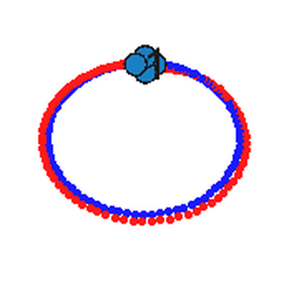
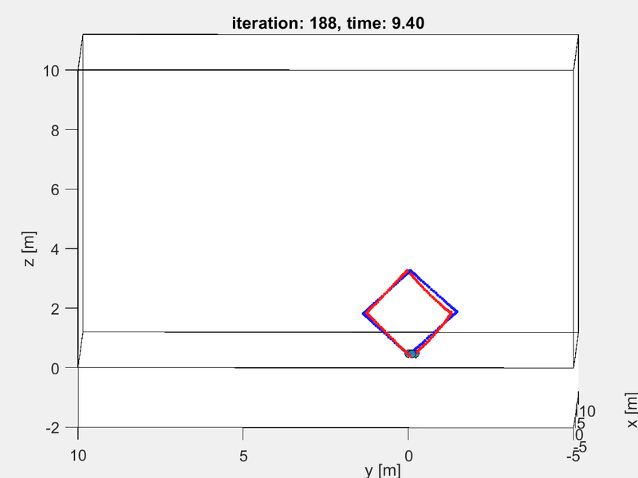
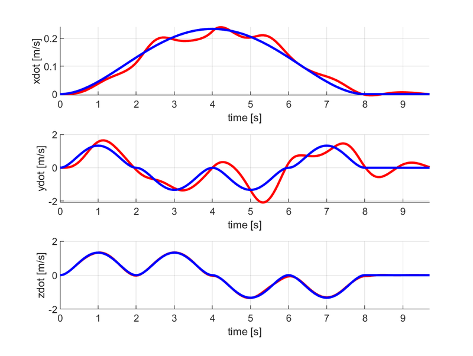

# PD & LQR Control for Quadrotor Trajectory Tracking

A MATLAB simulation that designs, implements and compares two controllers for autonomous quadrotor flight: a **Proportional-Derivative (PD)** controller and a **Linear Quadratic Regulator (LQR)**. The controllers are first used to fly a **Crazyflie** quadrotor to a target and hover there, and then to track full 3D trajectories. Both are run on a **circle** and a **diamond** trajectory and compared on tracking accuracy and computational cost.

Final project for **RBE 502: Robot Control, WPI**. Built on the course's Crazyflie quadrotor simulator.

<table>
  <tr>
    <th></th>
    <th>Circle (top view)</th>
    <th>Diamond (side view)</th>
  </tr>
  <tr>
    <td><b>PD</b></td>
    <td></td>
    <td></td>
  </tr>
  <tr>
    <td><b>LQR</b></td>
    <td></td>
    <td></td>
  </tr>
</table>
<p align="center"><em>Blue: desired path. Red: path actually flown.</em></p>

## Overview

A quadrotor is controlled through four inputs: the collective thrust `u1` and the three body moments `u2 = [Mx, My, Mz]`. Both controllers compute these from the current state and the desired trajectory.

Both are designed under a **near-hover assumption**: the roll and pitch angles stay small, and the thrust stays close to the value needed to hover. Under this assumption, the trigonometric terms in the dynamics can be approximated (for example, `sin φ ≈ φ` and `cos φ ≈ 1`), which makes the model much simpler to design around. The cost is that the quadrotor is limited to smooth, non-aggressive maneuvers.

The desired position, velocity, acceleration and yaw at each moment come from smooth polynomial trajectories in `traj/`:

- **Circle:** a 1 m radius loop in the horizontal plane over 8 s, climbing to 0.5 m.
- **Diamond:** a diamond in the vertical (y–z) plane, flown as four 2 s segments with sharp corners.

## PD controller

`control/pid_controller.m` is a **cascaded** controller with an outer position loop and an inner attitude loop. This structure follows from how a quadrotor moves: its thrust always points along its body axis, so to accelerate sideways it has to tilt first. The position loop therefore decides how much to accelerate in each direction, and the attitude loop tilts the quadrotor to produce that acceleration.

1. **Position loop.** For each axis, the commanded acceleration is the trajectory's own acceleration (feedforward) plus PD feedback on the position and velocity errors:

   ```
   r̈_des = r̈_T + Kd·(ṙ_T − ṙ) + Kp·(r_T − r)
   ```

   The vertical component sets the thrust, `u1 = m·g + m·r̈_des,z`. The horizontal components are converted into the desired roll and pitch angles using the near-hover equations and the desired yaw.

2. **Attitude loop.** The moments are computed with PD feedback on the errors in the Euler angles and body rates, scaled by the inertia matrix:

   ```
   u2 = I·(Kp,att·(angle error) + Kd,att·(rate error))
   ```

   The roll and pitch targets come from the position loop, and the yaw target comes from the trajectory.

The gains were tuned by hand. Position: `Kp = [11, 11, 12]`, `Kd = [10.4, 10.4, 10]` for x, y and z. Attitude: `Kp = [74, 74, 20]`, `Kd = [58, 58, 15]` for roll, pitch and yaw.

## LQR controller

`control/lqr_controller.m` takes a different approach. Instead of separate loops, it treats the quadrotor as one **12-state system**: position, Euler angles, linear velocity and body rates. It then computes all four inputs together, with a gain that is optimal for the current point on the trajectory.

1. **Model.** The near-hover dynamics are written as `ẋ = f(x, u)`. They combine the kinematics (position and angle rates), the near-hover translational accelerations, and the rotational dynamics `ṗ = Mx/Ixx`, `q̇ = My/Iyy`, `ṙ = Mz/Izz`.

2. **Linearization along the trajectory.** LQR requires a linear model, so at every time step `f` is linearized around where the quadrotor *should* be: the desired state from the trajectory, with the hover input `u_des = [m·g; 0; 0; 0]`. The Jacobians `A = ∂f/∂x` (12×12) and `B = ∂f/∂u` (12×4) were derived analytically. Because they are re-evaluated at every step, the model stays accurate as the reference moves.

3. **Optimal gain.** MATLAB's `lqr(A, B, Q, R)` solves the Riccati equation for the gain `K` that minimizes a quadratic cost, which trades off tracking error against control effort. The control applied is:

   ```
   u = K·(x_des − x) + u_des
   ```

4. **Weights.** `Q = diag([10,10,10, 1,1,10, 10,10,10, 0.1,0.1,0.1])` puts the highest weight on position, velocity and yaw, for tight tracking and less drift while turning. `R = diag([0.1, 1, 1, 1])` penalizes thrust less than the moments.

## Results

Both controllers complete both trajectories, but LQR tracks them more closely. In the flight paths at the top, LQR stays close to the diamond's edges, while the PD path overshoots the corners and drifts off some of the edges.

The difference is clearest in **velocity tracking on the diamond**, where the sharp corners require rapid changes of direction:

<table>
  <tr>
    <th>PD</th>
    <th>LQR</th>
  </tr>
  <tr>
    <td></td>
    <td></td>
  </tr>
</table>
<p align="center"><em>Velocity on the diamond trajectory. Blue: desired. Red: actual.</em></p>

- **Tracking accuracy:** PD overshoots at each corner and keeps oscillating after the trajectory ends. LQR tracks the desired velocity closely, with lower position and velocity errors overall.
- **Computational cost:** LQR re-linearizes the model and solves the Riccati equation at every step, which makes it significantly slower to run than PD.
- **Trade-off:** PD is simpler to implement and tune, while LQR gives noticeably better tracking on dynamic trajectories.

## Repository structure

| Path | Description |
|------|-------------|
| `control/pid_controller.m` | PD position and attitude controller. |
| `control/lqr_controller.m` | LQR controller: per-step linearization and `lqr()`. |
| `traj/circle.m`, `traj/diamond.m` | Circle and diamond trajectory generators. |
| `traj/jump.m` | Step trajectory used for the hover test. |
| `test_trajectory.m` | Simulation loop: selects the controller and trajectory, runs the simulation and plots the results. |
| `runsim.m` | Entry point: sets the start and goal and calls `test_trajectory`. |
| `dynamics/` | Quadrotor equations of motion and Crazyflie parameters. |
| `utils/` | Rotation and quaternion helpers, plotting, map loading and collision checking (simulator framework). |
| `maps/` | Example environment maps. |
| `media/` | Figures used in this README. |

## Stack

`MATLAB` · `PD control` · `LQR` · `Linearization` · `Trajectory generation` · `Quadrotor dynamics`

## Running it

Requires MATLAB with the **Control System Toolbox** (for `lqr`).

1. Choose the trajectory and controller near the top of `test_trajectory.m`:
   ```matlab
   trajhandle    = @circle;        % or @diamond
   controlhandle = @pid_controller; % PD
   % controlhandle = @(qd, t, qn, params)lqr_controller(qd, t, qn, params, trajhandle);  % LQR
   ```
2. From the repo root, run:
   ```matlab
   runsim
   ```

The simulator animates the flight in 3D, then plots the desired (blue) and actual (red) position and velocity.

## Acknowledgements

Built on the RBE 502 (WPI) Crazyflie quadrotor simulator framework. The design and tuning of the PD and LQR controllers, and the trajectory-tracking comparison, are my own work.

**Laasya Kodandaramu**
