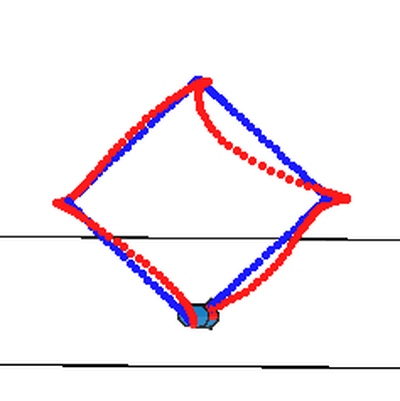
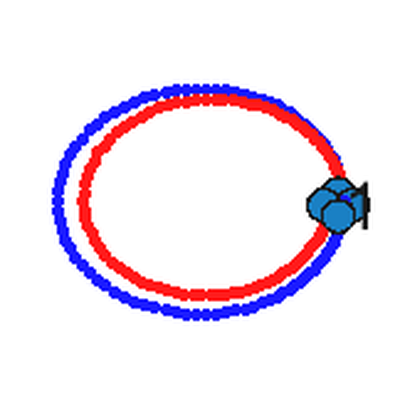
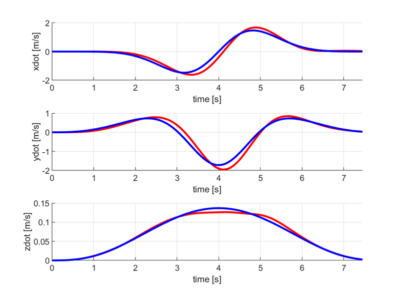
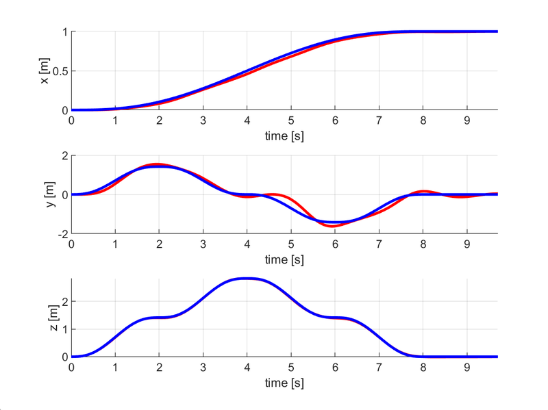
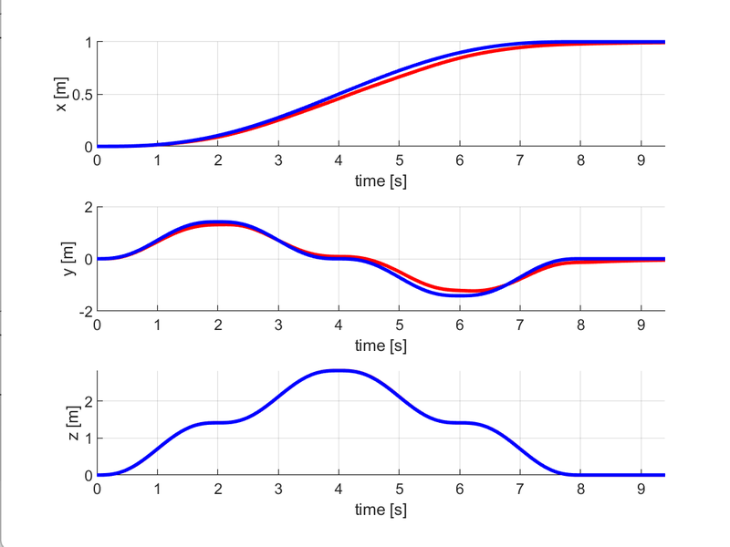

# PD & LQR Control for Quadrotor Trajectory Tracking

A MATLAB simulation comparing two controllers for a **Crazyflie quadrotor**: a cascaded **PD controller** and a **Linear Quadratic Regulator (LQR)** that is re-linearized around the desired state at every time step. Both controllers fly the same **circle** and **diamond** trajectories, and are compared on how closely they track the desired position and velocity and on how much computation they need.

Final project for **RBE 502: Robot Control, WPI**. Built on the course's Crazyflie quadrotor simulator.

<table>
  <tr>
    <th></th>
    <th>Circle (top view)</th>
    <th>Diamond (side view)</th>
  </tr>
  <tr>
    <td><b>PD</b></td>
    <td></td>
    <td></td>
  </tr>
  <tr>
    <td><b>LQR</b></td>
    <td></td>
    <td></td>
  </tr>
</table>
<p align="center"><em>Blue: desired path. Red: path actually flown.</em></p>

---

## Overview

- **Goal:** compute the four control inputs, total thrust `u1` and body moments `u2 = [Mx, My, Mz]`, that make the quadrotor follow a desired trajectory.
- **Assumption:** the quadrotor stays close to hover throughout, so roll and pitch remain small. This makes the near-hover equations below valid and rules out aggressive maneuvers.
- **Project phases:** the PD controller was first tuned to fly to a goal point and hover within position and velocity tolerances. It was then used for trajectory tracking, and an LQR controller was added for comparison.

---

## Trajectories

Both trajectories are generated in `traj/` as smooth polynomials, giving the desired position, velocity, acceleration and yaw at every time `t`.

- **Circle** (`traj/circle.m`): one full loop of radius 1 m in the horizontal plane over 8 s, climbing to 0.5 m. The angle and height follow 7th-order polynomials, so the motion starts and ends at rest.
- **Diamond** (`traj/diamond.m`): a diamond in the y–z plane, flown in four 2 s legs reaching a height of about 2.8 m, while x moves slowly from 0 to 1 m. Each leg is a 5th-order polynomial that starts and ends at zero velocity and acceleration.

---

## PD controller (`control/pid_controller.m`)

A cascaded controller: an outer **position loop** computes the thrust and the desired attitude, and an inner **attitude loop** computes the moments.

**Position loop.** For each axis, the commanded acceleration combines the trajectory's own acceleration with feedback on the position and velocity errors:

```
r̈_des = r̈_T + Kd·(ṙ_T − ṙ) + Kp·(r_T − r)
```

Near hover, vertical acceleration depends only on thrust, which gives `u1 = m·g + m·r̈_des,z`. Horizontal acceleration depends on roll and pitch, so the desired roll `φ_des` and pitch `θ_des` are solved from `r̈_des,x`, `r̈_des,y` and the desired yaw `ψ_T`.

**Attitude loop.** PD feedback on the angle and angular-rate errors, scaled by the inertia matrix `I`:

```
u2 = I · [ Kp,φ(φ_des − φ) + Kd,φ(p_des − p)
           Kp,θ(θ_des − θ) + Kd,θ(q_des − q)
           Kp,ψ(ψ_des − ψ) + Kd,ψ(r_des − r) ]
```

The desired roll and pitch rates are zero, and the desired yaw and yaw rate come from the trajectory.

**Tuned gains:**

| Loop | Gain | x / roll | y / pitch | z / yaw |
|------|------|---|---|---|
| Position | Kp | 11 | 11 | 12 |
| Position | Kd | 10.4 | 10.4 | 10 |
| Attitude | Kp | 74 | 74 | 20 |
| Attitude | Kd | 58 | 58 | 15 |

---

## LQR controller (`control/lqr_controller.m`)

**State and input.** A 12-dimensional state and 4 inputs:

```
x = [ position (3); Euler angles φ, θ, ψ (3); linear velocity (3); body rates p, q, r (3) ]
u = [ u1 (thrust); u2 (moments Mx, My, Mz) ]
```

**Dynamics.** The near-hover model `ẋ = f(x, u)` combines:

- the position derivative, which is the velocity
- the Euler-angle rates, converted from the body rates `p, q, r`
- the near-hover translational accelerations, the same equations used by the PD controller
- the angular accelerations `ṗ = Mx/Ixx`, `q̇ = My/Iyy`, `ṙ = Mz/Izz`

**Linearizing along the trajectory.** At every time step, `f` is linearized around the current desired state `x_des` and nominal input `u_des = [m·g; 0; 0; 0]` (hover thrust and no moments). This gives the Jacobians `A = ∂f/∂x` (12×12) and `B = ∂f/∂u` (12×4), which are derived analytically and evaluated at `x_des`. The tracking error then follows `e_{i+1} ≈ A·e_i + B·e_u,i`.

**Optimal gain.** MATLAB's `lqr(A, B, Q, R)` solves the Riccati equation for the gain `K` that minimizes the quadratic cost on state error and control effort. The control applied is:

```
u = K·(x_des − x) + u_des
```

**Weights:**

- `Q = diag([10, 10, 10,  1, 1, 10,  10, 10, 10,  0.1, 0.1, 0.1])`: high weights on position and velocity for tight tracking, and on yaw to limit drift while turning.
- `R = diag([0.1, 1, 1, 1])`: thrust is penalized less than the moments.

---

## Results

### Velocity tracking

The clearest difference between the two controllers is in velocity tracking. Blue is desired and red is actual.

<table>
  <tr>
    <th></th>
    <th>PD</th>
    <th>LQR</th>
  </tr>
  <tr>
    <td><b>Circle</b></td>
    <td></td>
    <td></td>
  </tr>
  <tr>
    <td><b>Diamond</b></td>
    <td></td>
    <td></td>
  </tr>
</table>

<details>
<summary><b>Position tracking plots</b></summary>

<table>
  <tr>
    <th></th>
    <th>PD</th>
    <th>LQR</th>
  </tr>
  <tr>
    <td><b>Circle</b></td>
    <td></td>
    <td></td>
  </tr>
  <tr>
    <td><b>Diamond</b></td>
    <td></td>
    <td></td>
  </tr>
</table>

</details>

### Comparison

- **Both controllers complete both trajectories** and stay close to the desired path.
- **PD has larger velocity errors.** On the diamond, its y-velocity overshoots at each corner and keeps oscillating after the trajectory ends. On the circle, it lags slightly behind the desired motion.
- **LQR tracks velocity much more closely.** It follows the corners of the diamond without the oscillations, and its position and velocity errors are lower overall. On the circle it stays in phase with the desired motion, though it cuts slightly inside the circle.
- **LQR is much more expensive to run.** Re-linearizing the dynamics and solving the Riccati equation at every time step makes it far slower than PD. PD is simpler to implement and tune, but less accurate on dynamic trajectories.

---

## Repository structure

| Path | Description |
|------|-------------|
| `control/pid_controller.m` | PD position and attitude controller. |
| `control/lqr_controller.m` | LQR controller: per-step linearization and `lqr()`. |
| `traj/circle.m`, `traj/diamond.m` | Circle and diamond trajectory generators. |
| `traj/jump.m` | Step trajectory used for the hover test in the first phase. |
| `test_trajectory.m` | Simulation loop: selects the controller and trajectory, runs the simulation and plots the results. |
| `runsim.m` | Entry point: sets the start and goal and calls `test_trajectory`. |
| `dynamics/` | Quadrotor equations of motion and Crazyflie parameters. |
| `utils/` | Rotation and quaternion helpers, plotting, map loading and collision checking (simulator framework). |
| `maps/` | Example environment maps. |
| `media/` | Figures used in this README. |

---

## Stack

`MATLAB` · `PD control` · `LQR` · `Linearization` · `Trajectory generation` · `Quadrotor dynamics`

---

## Running it

Requires MATLAB with the **Control System Toolbox** (for `lqr`).

1. Choose the trajectory and controller near the top of `test_trajectory.m`:
   ```matlab
   trajhandle    = @circle;        % or @diamond
   controlhandle = @pid_controller; % PD
   % controlhandle = @(qd, t, qn, params)lqr_controller(qd, t, qn, params, trajhandle);  % LQR
   ```
2. From the repo root, run:
   ```matlab
   runsim
   ```

The simulator animates the flight in 3D, then plots the desired (blue) and actual (red) position and velocity.

---

## Acknowledgements

Built on the RBE 502 (WPI) Crazyflie quadrotor simulator framework. The design and tuning of the PD and LQR controllers, and the trajectory-tracking comparison, are my own work.

**Laasya Kodandaramu**
