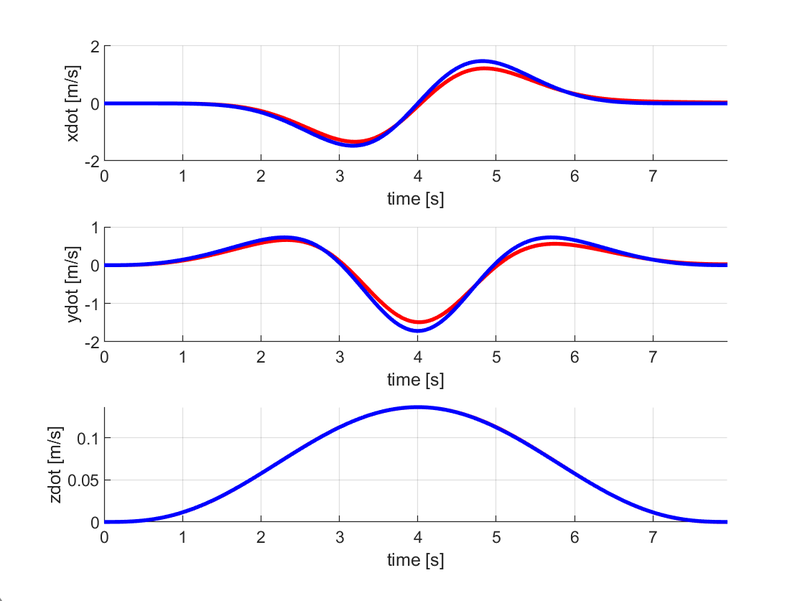
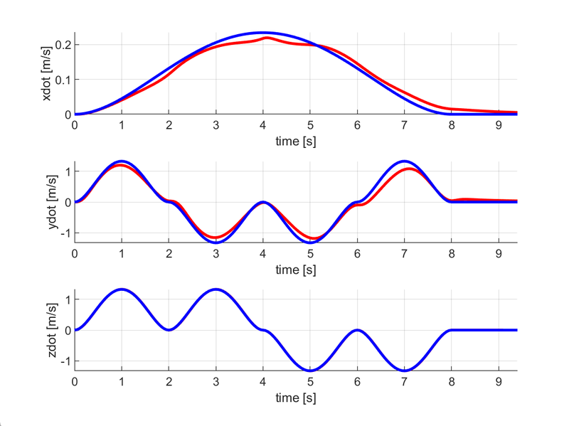
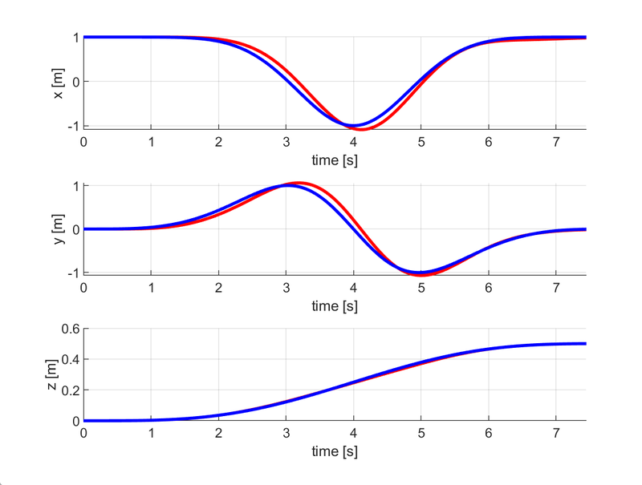
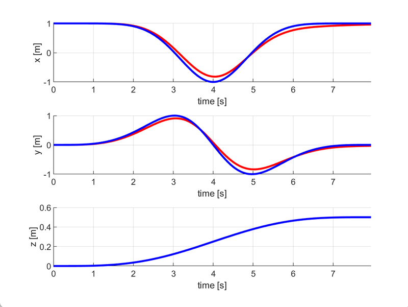

# PD & LQR Control for Quadrotor Trajectory Tracking

A MATLAB simulation comparing two controllers for a **Crazyflie quadrotor**: a cascaded **PD controller** and a **Linear Quadratic Regulator (LQR)** that is re-linearized around the desired state at every time step. Both controllers fly the same **circle** and **diamond** trajectories, and are compared on how closely they track the desired position and velocity and on how much computation they need.

Final project for **RBE 502: Robot Control, WPI**. Built on the course's Crazyflie quadrotor simulator.

<table>
  <tr>
    <th></th>
    <th>Circle (top view)</th>
    <th>Diamond (side view)</th>
  </tr>
  <tr>
    <td><b>PD</b></td>
    <td></td>
    <td></td>
  </tr>
  <tr>
    <td><b>LQR</b></td>
    <td></td>
    <td></td>
  </tr>
</table>
<p align="center"><em>Blue: desired path. Red: path actually flown.</em></p>

---

## Overview

The quadrotor is assumed to stay close to hover, with small roll and pitch. Each controller computes the four control inputs, total thrust `u1` and body moments `u2 = [Mx, My, Mz]`, that keep it on the desired trajectory.

- **PD controller:** a cascaded controller. A position loop turns position and velocity errors into a desired acceleration, which gives the thrust `u1` and the desired roll and pitch. An attitude loop then produces the moments `u2`.
- **LQR controller:** at every time step, the nonlinear dynamics are linearized around the desired state into `A` and `B`, and MATLAB's `lqr()` computes the optimal gain `K`. The control is `u = K·(x_des − x) + u_des`, where `u_des` is the hover input.

The desired position, velocity, acceleration and yaw come from smooth polynomial trajectories in `traj/`: a **circle** (radius 1 m, climbing to 0.5 m) and a **diamond** in the y–z plane, each flown in 8 s.

---

## Approach

**PD controller** (`control/pid_controller.m`)
- **Position loop:** `r̈_des = r̈_T + Kd·(ṙ_T − ṙ) + Kp·(r_T − r)`, giving the thrust `u1 = m·g + m·r̈_des,z`.
- **Attitude loop:** the desired roll and pitch are solved from the commanded horizontal acceleration and desired yaw. The moments are `u2 = I·(Kp,att·e_angle + Kd,att·e_rate)`.
- **Gains:** position `Kp = [11, 11, 12]`, `Kd = [10.4, 10.4, 10]`; attitude `Kp = [74, 74, 20]`, `Kd = [58, 58, 15]` (roll, pitch, yaw).

**LQR controller** (`control/lqr_controller.m`)
- **Model:** 12 states `x = [position; Euler angles; linear velocity; body rates]` and 4 inputs `u = [u1; u2]`.
- **Linearization:** at each step, the near-hover dynamics `ẋ = f(x, u)` are linearized analytically around the desired state and hover input, giving `A` (12×12) and `B` (12×4). Then `K = lqr(A, B, Q, R)`.
- **Weights:** `Q = diag([10,10,10, 1,1,10, 10,10,10, 0.1,0.1,0.1])` weights position, velocity and yaw most for tight tracking. `R = diag([0.1, 1, 1, 1])` penalizes thrust less than the moments.

---

## Results

### Velocity tracking

Velocity tracking shows the clearest difference between the two controllers (blue: desired, red: actual).

<table>
  <tr>
    <th></th>
    <th>PD</th>
    <th>LQR</th>
  </tr>
  <tr>
    <td><b>Circle</b></td>
    <td></td>
    <td></td>
  </tr>
  <tr>
    <td><b>Diamond</b></td>
    <td></td>
    <td></td>
  </tr>
</table>

<details>
<summary><b>Position tracking plots</b></summary>

<table>
  <tr>
    <th></th>
    <th>PD</th>
    <th>LQR</th>
  </tr>
  <tr>
    <td><b>Circle</b></td>
    <td></td>
    <td></td>
  </tr>
  <tr>
    <td><b>Diamond</b></td>
    <td></td>
    <td></td>
  </tr>
</table>

</details>

### Comparison

- **LQR tracks more accurately.** Position and especially velocity errors are lower. On the diamond, PD overshoots at each corner and oscillates, while LQR follows the corners smoothly.
- **PD is simpler** to implement and tune, but less accurate on these dynamic trajectories.
- **LQR costs more to run.** Re-linearizing and solving the Riccati equation at every step makes it much slower than PD.

---

## Repository structure

| Path | Description |
|------|-------------|
| `control/pid_controller.m` | PD position and attitude controller. |
| `control/lqr_controller.m` | LQR controller: per-step linearization and `lqr()`. |
| `traj/circle.m`, `traj/diamond.m` | Circle and diamond trajectory generators. |
| `traj/jump.m` | Step trajectory used for the hover test in the first phase. |
| `test_trajectory.m` | Simulation loop: selects the controller and trajectory, runs the simulation and plots the results. |
| `runsim.m` | Entry point: sets the start and goal and calls `test_trajectory`. |
| `dynamics/` | Quadrotor equations of motion and Crazyflie parameters. |
| `utils/` | Rotation and quaternion helpers, plotting, map loading and collision checking (simulator framework). |
| `maps/` | Example environment maps. |
| `media/` | Figures used in this README. |

---

## Stack

`MATLAB` · `PD control` · `LQR` · `Linearization` · `Trajectory generation` · `Quadrotor dynamics`

---

## Running it

Requires MATLAB with the **Control System Toolbox** (for `lqr`).

1. Choose the trajectory and controller near the top of `test_trajectory.m`:
   ```matlab
   trajhandle    = @circle;        % or @diamond
   controlhandle = @pid_controller; % PD
   % controlhandle = @(qd, t, qn, params)lqr_controller(qd, t, qn, params, trajhandle);  % LQR
   ```
2. From the repo root, run:
   ```matlab
   runsim
   ```

The simulator animates the flight in 3D, then plots the desired (blue) and actual (red) position and velocity.

---

## Acknowledgements

Built on the RBE 502 (WPI) Crazyflie quadrotor simulator framework. The design and tuning of the PD and LQR controllers, and the trajectory-tracking comparison, are my own work.

**Laasya Kodandaramu**
